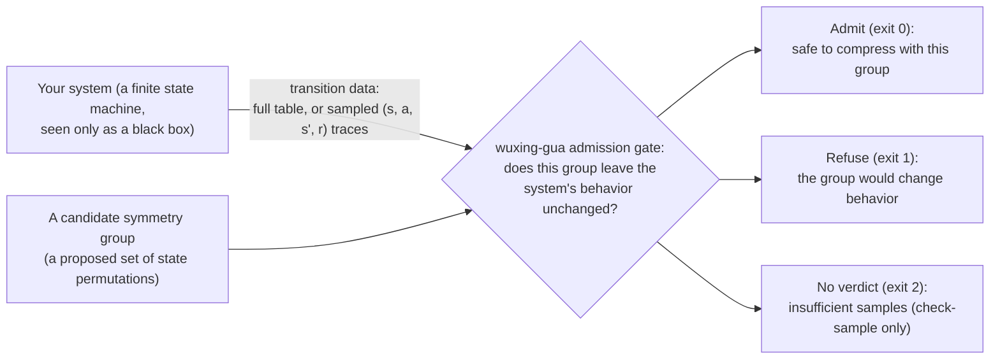

# wuxing-gua

> 📄 Now reading: **English** ｜ [🇨🇳 切换到简体中文](README.zh-CN.md)
> One-line explanations of every term are collected in [docs/glossary.md](docs/glossary.md); the sections below don't repeat them.

---

**Compressing a state space is easy. The precondition is where it bites.**

You have a system somewhere between a few thousand and a few tens of thousands of states. Ticket routing. Order lifecycle. Combat resolution. Protocol handshakes. Someone tells you the system has symmetry — that you can fold the state space down to a few hundredths of its size, and that the compute gets an order of magnitude or two cheaper. True. Mature technique.

There is a precondition, and it usually lives in a footnote: **the symmetry has to be real.**

Get one state wrong and the whole compression is wrong. It also **won't complain**. Compression finishes. The program runs. The output looks reasonable. It just isn't the real answer. You find out weeks later, or you never find out.

wuxing-gua does one thing: **it puts the symmetry through an inspection before you compress.**

Three possible verdicts:

| Verdict | What it means | Exit code |
|---|---|---|
| Admit | This symmetry survived a line-by-line comparison; go compress | `0` |
| Refuse | No — and here are **the specific spots** that don't line up | `1` |
| No verdict | Not enough data. I'm not calling it. | `2` |

It does not compress for you, and it does not replace the compression code you already have. It stands in front of it and answers one upstream question: **is this symmetry safe to use?**

The whole contract in one picture:



Python ≥ 3.10, zero third-party dependencies, `python -m wuxing_gua` runs straight out of the repo.

  

---

## 1. "Symmetry" just means "renaming"

A deck of cards. Swap two cards of the same rank and nothing about the hand changes. To you, those two cards differ **only in name**.

Systems have the same thing going on. A concrete example: a repair ticket walks through five stages — dispatched → accepted → en route → completed → closed. Suppose "accepted" and "en route" are business-equivalent in either order: accept then depart, or depart then accept, identical result. Then those two stages **can trade names**.

Trading names doesn't change behavior. That is what **symmetry** means here. The set of states that can trade names with each other is one **orbit** — in essence the same situation, so compression keeps one representative per orbit and throws the rest away.

But these name swaps rarely come in ones. Three interchangeable things give six ways to arrange them (3×2×1, counting "swap nothing" as one). **Collected together, those swaps form what mathematics calls a group.**

In one line: **a complete list of name swaps, closed under composition — do any two of them in a row and you land back inside the list.** How many entries the list has is its **order** — order 6 means six swaps.

> Why "group" and not just "list"? Mathematics adds one requirement: combine any two legal swaps and the result must still be a legal swap. A set of swaps that survives this is a group; an arbitrary bag of them may not be. The tool checks against the stricter standard.

**That is exactly what the mature technique does.** Tens of thousands of states down to hundreds, by keeping one per class.

Which leaves the question: **how do you know which two states really differ only in name?**

Eyeballing it works at 8 states. At 512 it stops working. At 16,384, forget it. And the price of getting it wrong is that the compressed system silently computes wrong answers.

That is the gap.

---

## 2. Why we built this — we got burned twice

There was no idea followed by a tool. There were two losses followed by a tool.

### Burn #1: a beautiful number that was really luck

Early on we had a flagship result. On one of our systems, the machine-found symmetry was **thousands of times larger** than the hand-analyzed one (40320 vs 16). We put it on the front page and left it there for a long while.

Then we ran a control experiment, and it was embarrassingly simple: **same system, only the state numbering shuffled. Not one character of the system itself changed.**

The number vanished.

A wider sweep was uglier still: 7 environments × 13 labelings = 91 controlled comparisons. Untreated search **threw the symmetry away entirely in 40.66%** of instances; canonical labeling repaired **85.71%**. In one environment (Q₆), only 2 of 13 renumberings produced the true group.

The "discovery" was never capability. It was the numbering, doing us a favor.

We didn't bury that. We quantified it, built three repair switches, and got **9 out of 9 environments correct** with everything switched on — only then did we start treating "automatic discovery" as a real capability again.

### Burn #2: our own alarm was wrong

The initial real-world case finished, and the confidence module lit up red across the board: "this group is incomplete!"

For most pipelines that is the end of the story. Believe the alarm or don't. No third door.

We took one more step: a separate brute-force program that enumerated every permutation (a permutation is one concrete way of relabelling). Verdict: **the tool had in fact found the whole group.** The alarm was a false positive on an unfamiliar environment shape.

That misfire didn't get buried either. It became an explicitly documented known boundary, plus a mandatory line in the output: "This threshold is calibrated on research environments; no claim holds on unfamiliar ones — trust the certificate or an independent check."

### Two burns, one sentence

**What this field lacks is not a better compression algorithm. It is the gate in front of compression.**

When all you hold is black-box data — a complete transition table, or a pile of `(state, action, next_state, reward)` logs — nobody answers "is this symmetry group actually safe on this system?" Most pipelines don't even have a refusal exit.

wuxing-gua is that gate.

---

## 3. Thirty seconds, one run

No install. From the repository root:

```bash
python -m wuxing_gua discover --trans examples/ticketfsm_milestones_model.json
```

That searches a real 32-state ticket model for symmetries and answers in seconds:

```json
{"order": 2, "n_orbits": 24, "trivial": false, ...}
```

**It found a symmetry with 2 rules** — the "accepted" and "en route" stages can swap — and folded 32 states into 24 classes.

`order: 2` sounds small, doesn't it? This isn't the tool being weak. It is **the answer**: in this ticket flow exactly one pair of stages is interchangeable, and nothing else is. Proving "there is no larger exploitable symmetry" is the work here — that kind of finding is worth just as much, because it stops you from guessing.

To see what a **refusal** looks like:

```bash
python -m wuxing_gua check --trans examples/tier1_starter_model.json \
  --group examples/tier1_xor_goalswap_group.json
echo $?      # 1
```

Don't rush to run it. This candidate looks entirely legal — it swaps paired adjacent vertices on a cube, and on the graph, arrows stay arrows. **Take a guess at whether it holds.**

Run it and you'll see it refused, with solid grounds: it moves the absorbing "goal" state somewhere else, and that state carries three self-loop edges (it stays put, doing nothing), so once moved it no longer matches its neighbors. Transition layer `worst_tv: 1.0`; reward layer (whether states in the same class show the same per-action payoffs), 4 pairs, all broken.

That is the whole contract in miniature: **what looks right can still be falsified; falsified means no admission; and it can say where the error is.**

**Why does it run without installing?** Because the judging core imports from the sibling `src/` tree by design (see the header note in `pyproject.toml`). Install only if you want the commands available from other directories:

```bash
pip install .
python -m wuxing_gua demo --out demo_fixtures   # deterministic demo fixtures (seconds)
python -m wuxing_gua selftest                   # end-to-end self-check: 15/15 branches PASS, exit 0
```

`selftest` only checks that the environment is wired up; it teaches you nothing about the tool. 15/15 PASS and exit code 0 means the install is fine.

Prefer plain language over JSON? `python -X utf8 wuxing_guard.py --model examples/ticketfsm_milestones_model.json` wraps the whole loop into one command — search, then verify, then a one-line human conclusion (worth compressing / don't / possible but not worth it). It is a thin wrapper over the same commands, speaking sentences instead of JSON; its own exit codes are `0` (a conclusion was reached) and `3` (couldn't run). See the header of [wuxing_guard.py](wuxing_guard.py).

---

## 4. Why it is allowed to say "no"

Two criteria, both zero tolerance:

| Layer | What it checks | Threshold |
|---|---|---|
| Transition | After renaming under **each and every** permutation in the candidate group, does every transition still line up? | max total variation TV ≤ 1e-9 (TV measures how far apart two distributions are; 0 means identical) |
| Reward | Do states inside the same orbit show consistent reward behavior? | 0 inconsistencies |

Both pass, admit. One spot fails, refuse immediately, `exit 1`.

Not sampling, not scoring, not "roughly consistent". Element by element, transition by transition, pair by pair. **6 permutations in the group means 6 full sweeps. 25 means 25.**

Past 5,000 elements the exhaustive sweep gets slow, so the tool switches itself to sentinel spot-checks (justified because equivariance is closed under composition: two legal swaps chained give another legal swap). Where that switch happens is written down in [docs/boundaries.md](docs/boundaries.md).

The core is those two criteria. Everything else is engineering: how to find candidates, how to handle numbering, what to say when the data is thin.

---

## 5. Three real systems, every reading on the table

All three cases transcribe a real system's behavior into a transition model, and **the decision rules were nailed down before the runs** (preregistered), not explained afterwards.

| System | Size | How we used it | External verification strength | Result |
|---|---|---|---|---|
| **ticketfsm**<br>ticket-dispatch state machine | 32 states × 5 actions | automatic search, `discover` | **Independent brute-force enumeration cross-check — the only case that has one**: a separately written exhaustive program confirms the true group is exactly the found one | order-2 group, 24 orbits, compression reading 1.33× — nothing missed, nothing extra |
| **a card-battle subsystem**<br>(generating-cycle chain × rotation field) | 512 states<br>(465 real + 47 padded) | candidate derived by hand + `check` | hand transcription + in-project independent arms (abstract group: 75 verified automorphisms with zero violations; linear-algebra determination of the bit-visible group H = 5) — **no third-party tool cross-check** | order-5 group passes both layers under zero tolerance, 128 orbits, 960 reward pairs with zero violations, compression reading 4.0×. **This case crashed partway through** — see below |
| **a two-team battle system**<br>(two independent chains + a shared rotation field) | 16,384 states<br>(14,415 real + 1,969 padded) | candidate derived by hand + `check` | hand transcription + in-project independent arms (abstract group: 375 verified automorphisms × 14,415 states × 11 actions zero-violation self-check, plus a 125-element contrast group rejected) — **no third-party tool cross-check** | order-25 group, 25/25 elements at TV = 0.00e+00, 176,640 reward pairs with zero violations, 1,024 orbits, reading 16.0× |

> **Read the verification column together with the ratios, not the ratios alone.** The only case with an independent brute-force cross-check is ticketfsm — and its compression reading is 1.33×. The 4.0× and 16.0× readings come from the two cases that have hand transcription, the tool's zero-tolerance check and in-project independent arms, but **no third-party tool cross-check**. Ratios are readings either way; the verification column is what says how far each reading has been independently tested.

That missing column now has a public home: [symmetry-court](https://github.com/cx2002302-lang/symmetry-court) puts this engine's verdicts on public standards (TCP RFC 9293, DHCP RFC 2131, IMAP RFC 3501) in front of a third-party arbiter (networkx) — every case reproducible from the RFC text, both action-name calibers side by side.

> Where "padded" comes from: the input convention is a bit-string shape (states written as strings of 0s and 1s, so the count must be a power of two: `n_states = 2^n_bits`), real state counts usually aren't a power of two, and the gap gets filled with dummy states — all self-loop, reward 0, standing for no real situation at all.

**The 512 case gets its own paragraph, because it was fixed after a crash.**

At that size `check` (verification) passed in seconds, but `discover` (automatic search) handed back nothing. Digging in, it wasn't a budget problem. It was a **blind spot**: when dummy states are present in the model, candidate generation systematically misses symmetry elements that cross between dummy and real states — all four candidate paths stuck at the same spot.

Once located, the fix went into the generation side; the criteria didn't move by a byte (new `--pad-aware` switch). Re-run: the 512-state model recovered the same order-5 group.

Separately, that model's transcription was replayed against the real engine: 120,000 steps, **100.000% agreement**.

**The 16,384 case is about what a capability boundary looks like.**

Verification took everything we threw at it: 25 elements, element by element, seconds. Search hit a wall: 900 s, 1,500 s, 3,600 s — all three budgets timed out cleanly. That boundary is written into the docs and labelled a declared budget ceiling, not "optimization in progress".

**A boundary is not a failure.** "Automatic search doesn't finish at this size" is usable information — it tells you when to derive the candidate by hand and when to change strategy.

### Two more independent calibrations

| Item | Numbers | Source |
|---|---|---|
| Confidence discriminator | 115 instances (**project self-constructed test set**), AUC = 1.0, error rate **0** at both ends | [evidence-data excerpt](docs/evidence-data/experiments_w3_discriminator_v2.json) |
| Adversarial false admission | 100 constructed should-refuse cases (**project self-constructed test set**), **0** admitted | [evidence-data excerpt](docs/evidence-data/experiments_p4.json) |

These two calibrations measure how strict the criteria are, not how real systems behave — which is why they are labelled as self-constructed sets rather than presented alongside the case studies above.

Compression factors are recorded as **readings only**, never as a benefit promise. On small models the tool's correct output is often a negative-result-style admission: "there is no larger exploitable symmetry".

Every number in sections 2, 5 and 6 is traceable: [docs/evidence.md](docs/evidence.md) maps each claim to a machine-readable record, and its anchors resolve to in-repo excerpts in [docs/evidence-data/](docs/evidence-data/INDEX.md) — all numbers check out from this repository alone, no access to the research repository needed.

---

## 6. Eight rungs — from "drawable on paper" to "16k states"

[examples/](examples/) holds eight graded samples, each rung harder than the last. Every rung ships the expected output of an actual run, so you can re-run it yourself.

| Rung | Real-world shape | States | What this rung shows you |
|---|---|---|---|
| **0 starter** | a backend with **three rollout switches**: 8 combinations | 8 | The symmetry is visible on paper. What the tool finds is what your eyes find. |
| **R refuse** | the same backend, one "looks legal" relabeling | 8 | The tool falsifies it on the spot and points at the offending spot |
| **S samples** | no full table, only **100 / 10,000** operation logs | 4 | With thin data it says "not enough", and never admits |
| **1a business constraint** | **two-channel reconciliation**: two payment channels, each collects then reconciles | 16 | Same code, with or without the business constraint, **24 relabelings collapse to 2** |
| **1c event actions** | a **close fragment with event-labeled edges** (teaching model) | 4 reachable | The same swap passes or is refused depending on the *declared* action reading — what your actions are is yours to declare |
| **1b real system** | the full **repair ticket dispatch** flow (real system, name anonymized) | 32 | Automatic search finds the group on the smallest real system, independently |
| **2 scale ×16** | **card-battle resolution** sequences | 512 | Verification holds up, search crashed and got fixed |
| **3 scale ×512** | **two-team battle** resolution | 16,384 | Verification passes in seconds, search hits a wall, the wall's location recorded as-is |

**Rung 1a gets its own paragraph, because it says the tool's value in one sentence.**

One order goes through two payment channels at once, each with two steps: collect, reconcile. Four binary bits, sixteen combinations. Treat those four bits as "four switches" and never ask about business rules — and the tool tells you: **any of the four stages can swap, group order 24, compression reading 3.2×.**

But the real rule is "inside a channel, reconciliation must come after collection". Encode the constraint, run again: **order 2 left (the two channels swapping), compression reading 1.6×.**

Same code, one constraint, a 12× difference in symmetry. **Take the 24 answer into compression and the compressed system is wrong — and it won't complain.**

This rung also demos something easy to miss. In the candidate that *should* be refused — swapping collect and reconcile inside one channel — **the reward layer passed everything (4 pairs, 0 inconsistencies). Only the transition layer caught it** (`TV = 1.0`). The division of labor is suddenly obvious: the reward layer checks whether same-class situations show consistent payoffs, the transition layer checks whether arrows still line up. Complementary, not redundant.

> This 16-state sample is a teaching model built for the repo, not a transcription of a real system. The generator script ships alongside it, so every number reproduces.

**The three rollout switches example is worth a pause too.** Three feature switches, eight combinations, and users can flip them in any order they like — so in your eyes those three switches are **completely equal**. The tool agrees: eight combinations fold into four classes, compression reading 2.0×. That is what symmetry looks like in ordinary code. Nothing mystical about it.

Full walkthroughs per rung (what to run, what lands on screen, how to read that output) are in [the sample walkthroughs](examples/).

---

## 7. What it doesn't do

This section matters more than the one above it.

| It doesn't | Detail |
|---|---|
| **Compress for you** | It only judges whether compression is allowed. Do the compression with the implementation you already have. |
| **Promise your system has symmetry** | Plenty of systems don't. Then you get "there is no larger exploitable symmetry" — which is also a useful answer. |
| **Promise it found everything** | `discover` is a search, and a search can miss. The completeness alarm and the confidence block are hints, not proof. **Only evidence you can show counts as a certificate.** |
| **Handle the abstraction layer** | Bit-string encoding cuts away part of the abstract automorphisms (an automorphism is a symmetry of the system with itself; measured: 75 → 5 and 375 → 25). The tool reports "the symmetry visible in this encoding" and doesn't pass it off as the abstract group. |
| **Soft-pedal the sampled path** | It needs ≥ 10,000 logs; below that it reports "insufficient data" rather than relaxing criteria to force an admission. On models with dummy states, dummy orbits can never be sampled, so the sampled verdict abstains **structurally** — a protocol limit, not a sample-size problem. |
| **Decide for you whether action names may be renamed** | It used to be unresolved (both readings are legitimate for different system classes). Since 2026-10-29 it is a **declaration**: the group file's `semantics` block states `relabel` (actions rename with states — switch/milestone systems) or `fixed` (event names pinned — event-driven machines like TCP); nothing declared means the relabel default runs with a loud `semantics_assumed` warning. `--strict` stays as the fixed override. **Which kind your actions are is still your call** — the tool only stops guessing for you: [docs/judge-semantics.md](docs/judge-semantics.md), runnable contrast in rung 1c |
| **Turn confidence into math** | The threshold was calibrated on 115 instances and is **not a mathematical proof**. Out-of-distribution shapes will misfire; we measured one (the full-scale false alarm in section 2). Which is why the suspicion tier force-attaches an out-of-distribution hint, and why the confidence block is read-only — it never changes the exit code. |

In one line: **the value here is in being willing to say no, not in promising yes.**

The research log behind this tool keeps 28 dead ends on file; the ten with the highest value to an outside user are distilled in [docs/negative-results.md](docs/negative-results.md) — that false alarm, that lucky number, that 16k timeout. Not a shame file. A set of coordinates.

---

## 8. How to fit your system in

Three common shapes. Find yours.

| Your system looks like | How to encode it | Matching sample |
|---|---|---|
| **N independent switches / feature bits**<br>(permissions, rollouts, config combinations) | one switch per bit, `n_states = 2^N`, action = flip bit a | rung 0 (three rollout switches) |
| **one flow through N stages**<br>(tickets, orders, approvals, release pipelines) | one bit per stage, "done" sets 1; illegal advances self-loop | rung 1b (repair tickets), rung S (log version) |
| **a group of sequences over a periodic field**<br>(card resolution, turn-based combat) | sequence state + period position, packed into a bit string | rungs 2 and 3 |

File formats (model / group / samples) are in [wuxing_gua/README.md](wuxing_gua/README.md). The questions that come up most — how to write the format, how many samples you need, what to do after a refusal — are answered in [docs/faq.md](docs/faq.md).

---

## 9. Exit codes and switches, cheat sheet

### Exit codes (uniform across all commands)

| Code | Meaning | What your script should do |
|---|---|---|
| `0` | Admit | Carry on and compress |
| `1` | Refuse (or `discover` only found the trivial group — the do-nothing swap and nothing else) | Stop; look where the `reason` field points |
| `2` | Insufficient data (`check-sample` only) | Get more data. Don't read it as an admission |
| `3` | Input or internal error | Check the file format |

**`2` is not `0`.** This is the most misread spot in the whole design: with thin data it declines to take a position instead of defaulting to pass.

### Six switches

Ignore them in normal use. Add one when you hit one of these:

| Your situation | Add this |
|---|---|
| Not sure what shape your input is (the default pick) | `--preset robust` (= all three: `--canonize` + `--extra-candidates` + `--multi-label 8`) |
| State numbering is database auto-increment IDs rather than natural | `--canonize` |
| The model has dummy states (from `2^n_bits` padding) | `--pad-aware` (dummy-state quotient-graph arm; repairs candidate generation for padded models) |
| `--canonize` gets suppressed or doesn't apply | `--multi-label K` (union of generators from K randomly-relabelled arms; K seeded via `--seed`) |
| The actions are themselves symmetric bijections | `--extra-candidates` (adds action-permutation candidate sources) |
| The completeness check has no certificate and you want one more reading | `--report-confidence` (read-only confidence block; never changes exit codes) |

One rule of thumb: **models where an action isn't "flip bit a"** (actions carry parameters, say) must use `--preset robust` or any two switches together. The single-switch bit-string criterion refuses or errors honestly on such models — **it won't admit them by accident.**

---

## 10. Doc map

| You want to know | Go here |
|---|---|
| Where every number comes from | [docs/evidence.md](docs/evidence.md) |
| One-line definitions of the terms | [docs/glossary.md](docs/glossary.md) |
| What each output field means | [docs/interpreting-output.md](docs/interpreting-output.md) |
| The most common questions | [docs/faq.md](docs/faq.md) |
| Boundaries and known limits | [docs/boundaries.md](docs/boundaries.md) |
| Dead ends on file (10 distilled here; 28 in the full research log) | [docs/negative-results.md](docs/negative-results.md) |
| A full walkthrough of getting started | [docs/quickstart.md](docs/quickstart.md) |
| Full flag × criterion table | [wuxing_gua/README.md](wuxing_gua/README.md) |
| Which action reading (`relabel` / `fixed`) your system needs, and how to declare it | [docs/judge-semantics.md](docs/judge-semantics.md) |
| Version history | [CHANGELOG.md](CHANGELOG.md) |
| How to contribute | [CONTRIBUTING.md](CONTRIBUTING.md) |

**License**: MIT (see [LICENSE](LICENSE)). Apache-2.0 is available if you prefer it; full text in [licenses/LICENSE-Apache-2.0.txt](licenses/LICENSE-Apache-2.0.txt).

**Contributing**: issues welcome — bugs, usage stories, and **negative results just as much**. "This group was refused / it timed out" is worth as much as "it judged correctly", because boundaries get mapped by people trying things.
