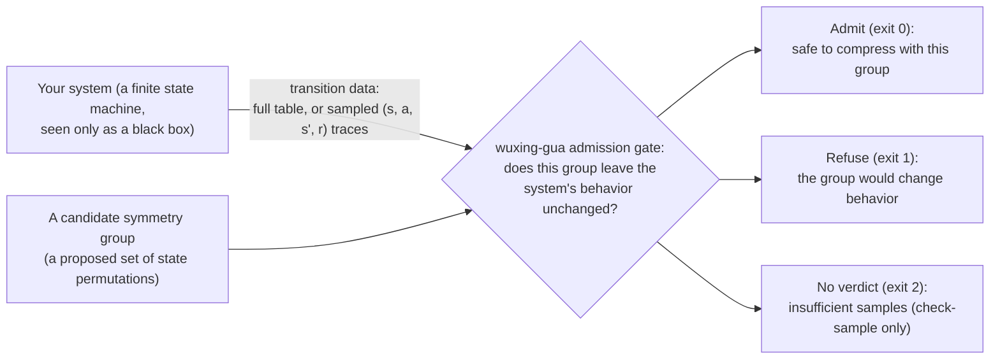

# wuxing-gua

**In one sentence**: a symmetry-admission checker — on black-box transition data, **before** any state compression, it decides whether a symmetry group **is safe to use**, and **refuses** when it is not.

[English](README.md) | [简体中文](README.zh-CN.md)

  

---

## 1. Why

Symmetry-based state-space reduction is a mature technique. What is missing is the gate in front of it: when all you have is **black-box transition data** (a full transition table, or `(s,a,s',r)` sample traces), **nobody answers "is this symmetry group actually safe to use on this system?"** — compressing with a wrong symmetry silently changes the system's semantics, and most pipelines have no way to *refuse*.

Concretely, a **symmetry group** here is a set of permutations of the states that leaves the system's behavior unchanged — relabel the states by any member of the set and every transition and reward stays the same. If a group qualifies, states in the same **orbit** (the states its permutations carry into each other) are interchangeable, so compression can keep one representative per orbit instead of every state. Whether a candidate group actually qualifies is exactly the question this tool decides.

wuxing-gua turns that question into a **refusal-capable admission gate**, built from four composable parts:

- **Discover** (`discover`): find candidate symmetry groups from transition data alone (multi-source candidate generation + labeling-robustness + a completeness alarm);
- **Zero-tolerance verification** (`check`): **every element** of the candidate group must pass an equivariance check and a reward-profile check; any single failure refuses;
- **Sample-based verdict** (`check-sample`): without a full transition table, an order-statistics criterion over sample traces answers "admit or not"; when samples are insufficient it says exactly that — it never passes just because "no difference was seen";
- **Calibrated confidence** (`--report-confidence`): when the completeness certificate is silent, an interpretable, calibrated "did we find the whole group?" reading.

The positioning is **compositional**: it does not replace any existing symmetry-reduction implementation; it sits in front of them and answers the two upstream questions — *should it be used at all, and can it refuse?*

The whole contract in one picture:



One-line definitions of every term used here — orbit, equivariance, total variation, generator, padding states, ... — are collected in [docs/glossary.md](docs/glossary.md).

## 2. Quickstart in 60 seconds

Requires Python ≥ 3.10; zero third-party dependencies (standard library only).

**Fastest first value — no install step.** From the repository root:

```bash
python -m wuxing_gua discover --trans examples/ticketfsm_milestones_model.json
```

That judges a real 32-state workflow model and prints the found group in seconds (exit 0: group order 2, 24 orbits). New to symmetry groups? Start one rung lower: the 8-state starter cube in [examples/](examples/) has a symmetry you can see on a paper diagram — and a companion group that looks legal but gets refused. Every command works this way — `python -m wuxing_gua ...` from the repository root — because the judging core imports from the sibling `src/` tree by design (see the header note in `pyproject.toml`). Install only if you want the commands available from other directories:

```bash
pip install .
python -m wuxing_gua demo --out demo_fixtures   # deterministic demo fixtures (seconds)
python -m wuxing_gua selftest                   # end-to-end self-check: 13/13 branches PASS, exit 0
```

A one-line `discover` example (the demo Q₆ standard environment, 64 states):

```bash
python -m wuxing_gua discover --trans demo_fixtures/model_q6.json
```

stdout is parseable JSON: `order=720`, `n_orbits=7`, plus a `completeness` alarm block; the output JSON is itself a valid group file you can feed straight back into `check`. Progress and diagnostics go to stderr. What every field means, and what to do next: [docs/interpreting-output.md](docs/interpreting-output.md).

To run the tool on your own system, describe its behavior as a JSON transition model in the tool's bit-string convention (`n_states = 2**n_bits`, action `a` = "flip bit `a`"); the exact file formats (model / group / samples) are documented in [wuxing_gua/README.md](wuxing_gua/README.md). The questions that come up first — formats, sample sizes, what to do after a refusal — are answered in [docs/faq.md](docs/faq.md).

## 3. Exit codes (uniform across commands)

| Exit code | Meaning |
|---|---|
| `0` | Usable: check / check-sample criteria pass; discover found a non-trivial group |
| `1` | Refuse: group unusable/illegal; discover only found the trivial group (order 1) |
| `2` | Insufficient data: the check-sample abstain tier — it only says samples are insufficient, no other conclusion |
| `3` | Input or internal error |

The admission criterion in one sentence: **zero-tolerance equivariance + reward profile** — every element of the candidate group must reach max total-variation TV ≤ 1e-9 (numerical zero), and same-orbit states must have zero reward-profile violations; both layers must pass to admit, any failure refuses (exit 1).

## 4. Evidence

Three real-system case studies (black-box transcribed into transition models; judgment rules preregistered before running). Every key reading is traceable — see [docs/evidence.md](docs/evidence.md) for the index:

| Case | Model size | Preregistered verdict | Key readings |
|---|---|---|---|
| ticketfsm (ticket-dispatch workflow FSM) | 32 states × 5 actions | primary prediction hit | check passes both layers; group order 2 = independently brute-force-verified \|Aut\|; 24 orbits, compression reading 1.333× |
| GameWXXX (generating-cycle chain × rotation field) | 512 states (465 real + 47 dummy) × 7 actions | repair loop closed | check on the order-5 group passes both layers (exit 0); after the fix, discover with `--pad-aware` recovers the same order-5 group (exit 0); 120,000 real engine executions match the transcription 100.000%; abstract group order 75 vs bitstring-visible order 5 (encoding-geometry boundary) |
| GameWXXX (team battle) | 16,384 states (14,415 real + 1,969 dummy) × 11 actions | primary prediction hit | check on the order-25 group passes both layers under zero tolerance: 25/25 elements at TV = 0.00e+00, reward profile 0 violations / 176,640 pairs; 1,024 orbits, compression reading 16.0×; the superseding 125-element abstract group is rejected, and its pass-set is exactly the order-25 group; discover times out cleanly at 3,600 s (the hard budget boundary at this scale) |

Independent calibration and adversarial testing:

- **Confidence discriminator**: 9 environments × 13 labelings, 115 instances — AUC = 1.0, error rate 0 at both ends;
- **Adversarial false-pass**: 100 constructed should-refuse cases, 0 wrongly admitted (0/100).

What the verdict column means: each case's outcome class and its pass rule were **preregistered** — written down before the runs that tested them — so "primary prediction hit" reports agreement with that pre-stated rule, not a post-hoc reading; "repair loop closed" marks the case where a defect was found, fixed, and the fix re-verified by re-running. The pre-stated rules are quoted in [docs/evidence.md](docs/evidence.md) (anchors E6, E17).

Compression ratios are reported as **readings only**, never as benefit claims — on small models the tool's correct output is often the negative-result-style admission "there is no larger exploitable symmetry".

## 5. Six flags at a glance

| Flag | What it does | When to use |
|---|---|---|
| `--preset robust` (recommended) | one-shot triple flag: `--canonize` + `--extra-candidates` + `--multi-label 8`, switching to the generalized judge | the default choice when the input shape is uncertain |
| `--canonize` | renumber canonically, then run the same search — removes labeling artifacts | when input labeling may not be "natural" |
| `--multi-label K` | union of generators from K randomly-relabeled search arms, closed (K seeded via `--seed`) | environments where canonize is suppressed / not applicable |
| `--extra-candidates` | add action-permutation candidate sources | models whose actions are themselves symmetric bijections |
| `--pad-aware` | dummy-state quotient-graph arm; repairs candidate generation for padded models | models containing all-self-loop dummy states (from the n_states = 2^n_bits padding) |
| `--report-confidence` | attach the read-only confidence block | when the completeness certificate is silent |

One-line rule: **non-bitstring action models** (actions ≠ "flip bit a") must use `--preset robust` or any two flags combined (the generalized judge); single-flag arms use the bitstring judge, which honestly refuses or errors on such models — it never wrongly admits.

## 6. Honest limits

- **Scale envelope (as measured)**: the check layer works on 16,384-state full tables (two zero-tolerance layers, seconds magnitude); the discover layer's measured convergence band is the 512-state band (`--pad-aware`, minutes magnitude), while at 16,384 states it times out cleanly at a 3,600 s budget — automatic discovery at that scale is a declared hard budget boundary, not an "impossible".
- **Element-wise verification cap**: groups up to 5,000 elements are verified element-by-element; larger groups automatically switch to sentinel spot-checks (justified by equivariance being closed under composition).
- **The confidence layer is an empirical calibration**: its statistical thresholds were calibrated on a 9-environment × 13-labeling matrix (115 instances) and are **not a mathematical guarantee**; out-of-distribution shapes (real business FSMs with dense self-loops, absorbing states, and guards) can produce false suspicion — one was actually observed: on ticketfsm the statistical layer raised `statistical_suspicion` (wl_gap = 6.0, full scale) while independent brute-force verification proved \|Aut\| = 2 with the group complete. That is why the suspicion tier force-attaches an out-of-distribution hint, and the confidence block is read-only — it never changes exit codes.
- **Sample-version threshold**: requires ≥ 10,000 sample traces (an empirically calibrated threshold); below it the tool reports abstain (exit 2) rather than loosening the criterion to force a pass. On padded models the dummy states' orbits can never be sampled, so the sample-based verdict abstains **structurally** — a protocol limitation, not a sample-size problem.
- **Visible symmetry ≤ abstract symmetry**: the affine constraints of bitstring encoding cut away part of the abstract automorphism group (measured as 75 → 5 and 375 → 25, same mechanism) — the tool reports the visible group as such and never passes it off as the abstract group.

## 7. Docs, license, contributing

- **Docs**: [docs/evidence.md](docs/evidence.md) (traceability index for every number) · [docs/glossary.md](docs/glossary.md) (plain-language definitions of the core terms) · [docs/interpreting-output.md](docs/interpreting-output.md) (what every output field means, with real values) · [docs/faq.md](docs/faq.md) (the questions that come up first) · [docs/quickstart.md](docs/quickstart.md) · [docs/boundaries.md](docs/boundaries.md) · [docs/negative-results.md](docs/negative-results.md) · [wuxing_gua/README.md](wuxing_gua/README.md) (full flag × judge table, file structure & provenance, known limitations) · [CHANGELOG.md](CHANGELOG.md) · [CONTRIBUTING.md](CONTRIBUTING.md)
- **Examples**: [examples/](examples/) is a six-rung ladder — an 8-state starter cube (`tier1_starter_model.json`) whose symmetry you can draw on paper, a runnable refusal demo (`tier1_xor_goalswap_group.json`), the transition models and group files of the three real cases above (the 32-state one with a wrong-candidate control pair), and a sample-based `check-sample` rung (an abstain/pass pair plus an honest refuse-at-any-size boundary demo), ready to re-run with recorded expected outputs.
- **License**: MIT (see [LICENSE](LICENSE)); Apache-2.0 is also available if preferred (full text at [licenses/LICENSE-Apache-2.0.txt](licenses/LICENSE-Apache-2.0.txt)).
- **Contributing**: issues welcome — bug reports, usage scenarios, and **negative results equally so** ("this group was refused / timed out" is as valuable as "it judged correctly").
