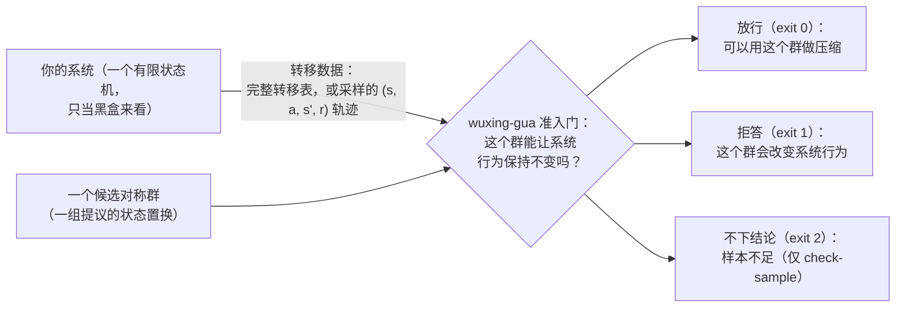

# wuxing-gua

> 📄 你正在看：**简体中文版** ｜ [🇬🇧 Switch to English](README.md)
> 术语的一句话解释集中在 [docs/glossary.zh-CN.md](docs/glossary.zh-CN.md)，本文每一节末尾不再重复。

---

**压缩状态空间这件事，坑不在算法，在前提。**

你手上有个系统，几千到几万个状态——工单流转、订单状态、游戏战斗、协议握手，都算。有人告诉你：这系统里有对称性，能把状态压到几百分之一，算得快几十倍。这话是对的，成熟技术。

但它有个前提，通常只写在脚注里：**那个对称性得是真的。**

错一个状态，整个压缩就是错的。而且它**不报错**——压缩照常完成，程序照常运行，输出看着挺合理，只是和真值不一样。等你发现，可能是几周后，也可能永远发现不了。

wuxing-gua 只做一件事：**压缩之前，把对称性过一遍安检。**

结论只有三种：

| 结论 | 意思 | 退出码 |
|---|---|---|
| 放行 | 这个对称性经得起逐条对照，可以拿去压缩 | `0` |
| 拒答 | 不行，而且告诉你**具体哪几处**对不上 | `1` |
| 不下结论 | 数据不够，我不判断 | `2` |

它不帮你压缩，也不替代你现有的压缩实现。它站在压缩前面，回答一个前置问题：**这个对称性，敢用吗？**

整个约定一张图：



Python ≥ 3.10，零第三方依赖，`python -m wuxing_gua` 直接跑。

  

---

## 1. 什么叫"对称性"——就是换名字

一副扑克，两张同点数的牌互换，牌局完全不变。这两张牌对你来说**只是名字不同**。

系统里也有这种东西。举个具体例子：一张维修工单，要经过"已派单 → 已接单 → 在途 → 已完成 → 已闭环"五个环节。如果其中"已接单"和"在途"这两步，谁先谁后在业务上完全等价——先接单再出发，或者先出发再接单，结果一模一样——那这两个环节就是**可以互换名字**的。

互换之后系统行为不变，这叫**对称性**（symmetry）。能互相换名字的那一批状态，叫一个**轨道**（orbit）——它们本质上是同一类局面，压缩时每类留一个代表就够了。

但这些"换名字"的办法很少只有一种。三个东西能互相换，排法就有 6 种（3×2×1，连"什么都不换"一起算）。**这些换法合起来，数学上叫一个「群」（group）。**

简单说，**它是一份完整的换名字清单，而且怎么组合都跑不出这份清单**。 清单里有几条，就叫它的**「阶」（order）**——阶是 6，就是有 6 种换法。

> 为什么非要叫"群"而不叫"清单"？因为数学上对它有个额外要求：两个合法的换法连着做，结果必须还是合法的换法。这份清单通常满足这个要求，而普通的"一堆换法"不一定满足。工具就是按这个更严的标准在检查。

**这就是那门成熟技术在做的事。** 几万状态压成几百，靠的就是"同类只留一个"。

问题在于：**你怎么知道哪两个状态真的只是名字不同？**

肉眼判断在 8 个状态上还行，512 个就不行了，16,384 个更别提。而判断错的代价是：压缩后的系统静默地算出错答案。

这就是缺口所在。

---

## 2. 我们为什么做这个工具——被坑过两次

不是先有想法再做工具，是先吃了两次亏。

### 第一次：一个漂亮数字，其实是运气

项目早期有个招牌结论：某个系统里，机器自动找到的对称性比人工分析的**大几千倍**（40320 vs 16）。我们拿它当了很久的门面。

后来做了个对照实验，非常简单：**同一个系统，只把状态编号打乱重排，系统本身一个字没改。**

那个数字没了。

再扫一遍就更难看了：7 个环境 × 13 种编号 = 91 组对照，不做处理的搜索有 **40.66%** 的实例把对称性彻底丢掉；换成规范编号能修复 **85.71%**。其中有一个环境（Q₆），13 次重编号里只有 2 次拿到真群。

原来那个"发现"不是能力，是编号给的运气。

我们没有把这段藏起来。我们把它量化了，做了三个修复开关，最后全开配置在 **9 个环境里 9 个全对**，才敢重新把"自动发现"当回事。

### 第二次：我们自己的警报错了

第一个真实案例跑完，工具的置信度模块亮满格红灯："这个群没找全！"

换一般流程，这就是结论了——要么信它，要么不信它，没有第三条路。

我们多走了一步：另写一个暴力程序，直接穷举所有置换（permutation，就是「换名字」的具体排法）。结论是：**工具其实找全了**，是置信度在新环境形态下误报了。

这次误报也没藏。它变成了文档里一条明写的已知边界，和输出里一句强制提示："此阈值在研究环境标定，陌生环境不保证，请以证书或独立验证为准。"

### 两次教训合成一句话

**这个领域缺的不是更好的压缩算法，是压缩前面那道门。**

当你手上只有黑盒数据——一张完整的转移表，或者一堆 `(状态, 动作, 下一状态, 回报)` 的日志——没有人回答"这个对称群用在这个系统上到底安不安全"。多数流程连"拒答"这个出口都没有。

wuxing-gua 就是那道门。

---

## 3. 三十秒，先跑一次

不用装。在仓库根目录：

```bash
python -m wuxing_gua discover --trans examples/ticketfsm_milestones_model.json
```

这条命令在一个真实的 32 态工单模型上自动搜对称性，秒级出结果：

```json
{"order": 2, "n_orbits": 24, "trivial": false, ...}
```

**它只找到一个 2 条规则的对称性**——"已接单"和"在途"这两个环节可以互换；32 个状态归成 24 类。

`order: 2` 听起来很小，对吧？但这不是"工具弱"，这是**答案本身**：这个工单流程里，真正可互换的只有那一对环节，再没有别的了。工具干的事是证明"没有更大的可利用对称"——这类结论同样值钱，因为它让你不必再猜。

想看它**拒答**长什么样：

```bash
python -m wuxing_gua check --trans examples/tier1_starter_model.json \
  --group examples/tier1_xor_goalswap_group.json
echo $?      # 1
```

先别急着跑。这个候选群看起来完全合法——它是立方体上"配对相邻顶点"的换位，在图上箭头还是箭头。**你先猜一下它成不成立。**

跑完你会看到它被拒，而且拒得很有依据：它把"终点"那个吸收态（走进去就不再有出路的落点）搬到了别的位置，而吸收态有三条自环边（原地不动、等于没走），被搬走之后就和邻居的行为对不上了。转移层 `worst_tv: 1.0`，奖励层（同一类局面下各动作的回报是否一致）4 对全坏。

这就是这个工具的契约，缩小版：**看起来对的，照样能证伪；证伪了就不放行；而且说得出错在哪。**

**为什么不用装就能跑？** 因为判据核心从同一目录树的 `src/` 导入，这是设计使然（见 `pyproject.toml` 头注）。只有当你想在别的目录也能用这些命令时，才需要装一下：

```bash
pip install .
python -m wuxing_gua demo --out demo_fixtures   # 生成确定性演示夹具（秒级）
python -m wuxing_gua selftest                   # 端到端自检：15 个分支全 PASS、退出码 0
```

`selftest` 只是检查环境装没装好，不教你任何东西。跑一次 15/15 全过、退出码 0，就说明安装没问题。

想看人话而不是 JSON？`python -X utf8 wuxing_guard.py --model examples/ticketfsm_milestones_model.json` 把整个闭环包成一条命令——搜索、验证、最后给一句结论（值得压 / 别压了 / 能压但不划算）。它只是同一组命令的薄封装，说的是句子而不是 JSON；自己的退出码只有 `0`（给出了结论）和 `3`（没能运行）。见 [wuxing_guard.py](wuxing_guard.py) 文件头。

---

## 4. 它凭什么敢说"不"

判据两条，都是零容忍：

| 层 | 查什么 | 门槛 |
|---|---|---|
| 转移层 | 按候选群里的**每一个**换法重命名后，每一条转移是否还对得上 | 最大全变差 TV ≤ 1e-9（TV 衡量「两边的差别有多大」，0 就是一模一样） |
| 奖励层 | 同一轨道里的状态，奖励表现是否一致 | 0 处不一致 |

两条全过才放行。任何一处不过，直接拒答，`exit 1`。

不是抽样、不是打分、不是"基本吻合"。是逐元素、逐转移、逐对比较。**群里有 6 个换法就查 6 遍，有 25 个就查 25 遍。**

群大到 5,000 个元素以上时，逐元素全查会变慢，工具自动切成哨兵抽查（依据：等变关系对复合封闭——两个都合法的换法连着做，还是合法的换法）。这个切换点写在 [docs/boundaries.md](docs/boundaries.md)。

判据核心就这两条。剩下的全是工程：怎么找候选、怎么处理编号、数据不够时怎么说话。

---

## 5. 三个真实系统，读数全公开

三个案例都是把真实系统的行为转录成转移模型，**判定规则在跑之前就写死了**（预注册），不是跑完再解释。

| 系统 | 规模 | 怎么用的 | 外部验证强度 | 结果 |
|---|---|---|---|---|
| **ticketfsm**<br>工单派单状态机 | 32 态 × 5 动作 | 自动搜索 `discover` | **独立暴力穷举对账——唯一有这一层的案例**：另写的穷举程序证实真群恰好就是找到的那个 | 阶 2 群，24 轨道，压缩读数 1.33×——没漏报，也没多报 |
| **卡牌战斗子系统**<br>（元素相生链 × 轮转场） | 512 态<br>（465 真实 + 47 补齐） | 人工推导候选 + `check` | 人工转录 + 项目内独立臂（抽象群 75 个自同构全验零违约；线性代数判定位串可见群 H = 5）——**无第三方工具对照** | 阶 5 群两层零容忍通过，128 轨道，960 对奖励零违约，压缩读数 4.0×。**这个案例中途翻过车**，见下 |
| **双人对战系统**<br>（两条独立链 + 共享轮转场） | 16,384 态<br>（14,415 真实 + 1,969 补齐） | 人工推导候选 + `check` | 人工转录 + 项目内独立臂（抽象群 375 个自同构 × 14,415 态 × 11 动作零违约自检；另有 125 元素对照群被拒）——**无第三方工具对照** | 阶 25 群 25/25 元素 TV = 0.00e+00，176,640 对奖励零违约，1,024 轨道，读数 16.0× |

> **请把「外部验证强度」这一列和倍数放在一起读，别只看倍数。** 唯一做过独立暴力穷举对账的案例是 ticketfsm——它的压缩读数只有 1.33×。4.0× 与 16.0× 这两个读数来自另外两个案例：有人工转录、有工具的零容忍验证、有项目内独立臂，但**没有第三方工具对照**。倍数永远只是读数；真正告诉你该信几分的是验证强度这一列。

> 「补齐」是这么来的：工具的输入约定是位串形状（状态用一串 0/1 表示，所以状态数必须是 2 的幂：`n_states = 2^n_bits`），真实状态数往往不是 2 的幂，不够的用"哑态"填充——哑态全自环、回报 0，不代表任何真实局面。

**512 那个案例值得单独说，因为它是翻车后修好的。**

在这个规模上，`check`（验证）秒过，但 `discover`（自动搜索）交不出东西。查下去发现不是预算问题，是**盲区**：模型里存在哑态时，候选生成会系统性地漏掉"跨哑态和真实态"的对称元素——四条候选路径全都卡在同一处。

定位清楚之后，修的是生成侧，判据一个字节没动（新增 `--pad-aware` 开关）。修完复跑，512 态模型重新找回了同一个阶 5 群。

另外，这个模型的转录本身也被回放过：12 万步真实引擎执行与转录结果 **100.000% 一致**。

**16,384 那个案例，讲的是能力边界长什么样。**

验证侧照单全收——25 个元素逐元素查，秒级。搜索侧撞墙：900 秒、1,500 秒、3,600 秒，三档预算全部干净超时。这条边界被写进文档，并注明它是已声明的预算上限，不是"正在优化"。

**边界不是失败。** "这个规模上自动搜索跑不完"是一个可用的信息——它告诉你什么时候该人工推导候选、什么时候该换策略。

### 另外两组独立校准

| 项目 | 数字 | 出处 |
|---|---|---|
| 置信判别分 | 115 个实例（**项目自构造测试集**），AUC = 1.0，两端错误率 **0** | [evidence-data 摘录](docs/evidence-data/experiments_w3_discriminator_v2.json) |
| 对抗误放行 | 100 个"该拒"的构造案例（**项目自构造测试集**），**0 个**被放进 | [evidence-data 摘录](docs/evidence-data/experiments_p4.json) |

这两组校准测的是判据有多严，不是真实系统表现如何——所以它们被标成"自构造测试集"，而不是和上面的真实案例并列陈列。

压缩倍数只作**读数**记录，不是收益承诺。小模型上，工具的正确产出经常是"证明没有更大的可利用对称"这种负结果式放行。

第 2、5、6 节的每个数字都可溯源：[docs/evidence.md](docs/evidence.md) 把每条主张映射到机读记录，其锚点已改指仓内摘录 [docs/evidence-data/](docs/evidence-data/INDEX.md)——不用接触研究仓，从本仓库就能核对全部数字。

---

## 6. 八级台阶——从"能画在纸上"到"1.6 万状态"

[examples/](examples/) 是八级样例，逐级加难度。每一级都附实跑的预期输出，可以直接复跑。

| 级 | 实际场景 | 状态 | 这一级让你看到什么 |
|---|---|---|---|
| **0 起步** | 后台**三个灰度开关**：任意组合 8 种 | 8 | 对称性在纸面上就能看见。工具找到的，和你眼睛看到的是同一个 |
| **R 拒答** | 同一个后台，一个"看着挺合法"的换法 | 8 | 工具当场证伪，并指出错在哪一处 |
| **S 采样** | 没有完整表，只有 **100 条 / 1 万条**操作日志 | 4 | 数据不够时它说"不够"，绝不放行 |
| **1a 业务约束** | **双渠道对账**：两个支付渠道，各自先收款后对账 | 16 | 同一份代码加不加业务约束，可用换法从 **24 种**降到 **2 种** |
| **1c 事件动作** | **带事件标签的收尾片段**（教学模型） | 4 可达态 | 同一个对换群，声明口径不同结论相反——动作是"状态位"还是"外部事件"由你声明 |
| **1b 真实系统** | **维修工单派单**全流程（真实系统，名字已匿名） | 32 | 自动搜索在最小真实系统上独立找到群 |
| **2 规模×16** | **卡牌战斗结算**序列 | 512 | 验证扛得住，搜索翻了车又修好 |
| **3 规模×512** | **双人对战**结算 | 16,384 | 验证秒过，搜索撞墙，墙的位置如实记录 |

**级 1a 值得单独讲，因为它一句话就说完了这个工具的价值。**

一笔订单同时走两个支付渠道，每个渠道两步：收款、对账。四个二进制位，十六种组合。如果只把这四个位当成"四个开关"，不问业务规则——工具会告诉你：**四个环节随便换，24 种换法全部成立，压缩读数 3.2×。**

但真实规则是"同一渠道内，对账必须在收款之后"。把这个约束写进模型，再跑一次：**只剩 2 种换法（两个渠道互换），压缩读数 1.6×。**

同一份代码，一条约束，可用的"换名字"方式从 24 种削到 2 种。**要是拿 24 那个结论去压缩，压出来的系统就是错的，而且它不会报错。**

这一级还演示了一件容易被忽略的事。在"该拒答"的那个候选里——把同一个渠道内的"收款"和"对账"互换——**奖励那一层居然全过（4 对 0 处不一致），只有转移那一层抓到它**（`TV = 1.0`）。两层的分工由此看得很清楚：奖励层查"同类局面的回报表现是否一致"，转移层查"箭头是否还对得上"，互补，不冗余。

> 这个 16 态样例是仓库新构造的教学模型，不是真实系统转录，生成脚本随样例提供，每个数字都可复现。

**三个灰度开关**这个例子也值得停一下。你后台有三个功能开关，八种开关组合，用户随便按哪个顺序开都行——那这三个开关在你眼里是**完全平等**的。工具会告诉你：确实平等，八种组合归成四类，压缩读数 2.0×。这就是"对称性"在你日常代码里的样子，一点不玄。

每一级的完整走查（跑什么命令、屏幕上蹦什么、那个输出怎么读）见 [样例走查](examples/)。

---

## 7. 它不管什么

这一节比上一节重要。

| 它不做 | 说明 |
|---|---|
| **不替你压缩** | 它只判断"能不能压"，压缩本身用你现有的实现 |
| **不保证你的系统有对称性** | 很多系统就是没有。这时候它给你的是一句"没有更大的可利用对称"——这也是有用的答案 |
| **不保证找全了** | `discover` 是搜索，搜索就有漏的可能。完整性告警和置信度块是提示，不是证明。**能拿出证据的才叫证书** |
| **不管抽象层** | 位串编码会砍掉一部分抽象自同构（自同构 = 系统跟自身的对称换法；实测 75 → 5、375 → 25 两例）。工具报的是"在这个编码上看得见的对称"，不冒充抽象群 |
| **采样版有硬门槛** | 需要 ≥ 10,000 条日志；低于门槛报"数据不足"，不靠放宽判据凑放行。含哑态的模型上，哑态轨道永远采不到样，采样判定会**结构性**弃权——这是协议限制，不是样本量问题 |
| **动作名能不能跟着换——不再替你猜** | 这曾是二义性（两种口径对两类系统各对一半）。2026-10-29 起改为**显式声明**：群文件的 `semantics` 块写明 `relabel`（动作随状态换名——开关/里程碑型）或 `fixed`（事件名钉死——事件驱动型，如 TCP）；什么都不写则按 relabel 判读并打上显眼的 `semantics_assumed` 警示。`--strict` 保留为 fixed 覆盖。**你的动作属于哪类仍要自己判断**，工具只是不再替你猜：[docs/judge-semantics.md](docs/judge-semantics.md)，可复现对照见 1c 级 |
| **置信度是经验标定** | 阈值在 115 个实例上标定，**不是数学保证**。分布外环境会误报，实测就有过一例（就是第 2 节那个满格假警报）。所以疑点档强制附"分布外环境提示"，而且置信块只读——永远不改退出码 |

一句话：**这个工具的价值在"敢说不"，不在"保证对"。**

项目的研究日志里存着 28 条走死的方向；其中对外部用户最有价值的 10 条提炼在 [docs/negative-results.md](docs/negative-results.md)——包括上面那个假警报、那个幸运数字、那个 16k 超时。这些不是黑历史，是坐标。

---

## 8. 你的系统怎么套进来

三种最常见的形状，对号入座：

| 你的系统长这样 | 怎么编码 | 对应样例 |
|---|---|---|
| **N 个独立开关/功能位**<br>（权限、灰度、配置组合） | 每位一个开关，`n_states = 2^N`，动作 = 翻第 a 位 | 级 0（三个灰度开关） |
| **一条流程走 N 个环节**<br>（工单、订单、审批、发布流水线） | 每位一个环节，"已完成"置 1；非法推进自环 | 级 1b（维修工单）、级 S（日志版） |
| **一组序列叠加一个周期场**<br>（卡牌结算、回合制战斗） | 序列状态 + 周期位置，拼成位串 | 级 2、级 3 |

文件格式（model / group / samples 三种）在 [wuxing_gua/README.md](wuxing_gua/README.md)。最高频的问题——格式怎么写、样本要多少、被拒答之后怎么办——在 [docs/faq.md](docs/faq.md)。

---

## 9. 退出码与开关速查

### 退出码（全命令统一）

| 码 | 含义 | 脚本里怎么处理 |
|---|---|---|
| `0` | 放行 | 继续压缩 |
| `1` | 拒答（或 `discover` 只找到平凡群，即「只有什么都不换」这一种） | 停下，看 `reason` 字段指出的位置 |
| `2` | 数据不足（只有 `check-sample`） | 补数据，不要当放行 |
| `3` | 输入或内部错误 | 查文件格式 |

**`2` 不是 `0`。** 这是设计上最容易被误读的一处：数据不够时它拒绝表态，而不是默认放行。

### 六个开关

平时不用管。按"你遇到什么情况"查这张表：

| 你遇到的情况 | 加这个 |
|---|---|
| 不确定输入是什么形状（默认选它） | `--preset robust`——一键三开：`--canonize` + `--extra-candidates` + `--multi-label 8`，并切到泛化判据 |
| 状态编号是数据库自增 ID 那种，不是"自然的" | `--canonize`（规范化重编号，消掉编号造成的假象） |
| 模型里有哑态（`2^n_bits` 补齐产生的） | `--pad-aware`（哑态商图臂，修复含哑态模型的候选生成） |
| `--canonize` 被抑制或不适用 | `--multi-label K`（K 个随机重编号臂的生成元并集，K 由 `--seed` 控制） |
| 动作本身也是对称的双射 | `--extra-candidates`（追加动作置换候选源） |
| completeness 拿不出证书，想多一个判读 | `--report-confidence`（附只读 confidence 诊断块，永不改退出码） |

一条口径：**动作不是"翻第 a 位"的模型**（比如动作本身带参数），必须走 `--preset robust` 或任意两开关组合（泛化判据）。单开关的位串判据对这类模型会如实拒答或报错，**不会误放行**。

---

## 10. 文档地图

| 你想知道 | 去哪 |
|---|---|
| 每个数字的出处 | [docs/evidence.md](docs/evidence.md) |
| 术语一句话解释 | [docs/glossary.zh-CN.md](docs/glossary.zh-CN.md) |
| 输出里每个字段什么意思 | [docs/interpreting-output.md](docs/interpreting-output.md) |
| 最高频的问题 | [docs/faq.md](docs/faq.md) |
| 边界与已知限制 | [docs/boundaries.md](docs/boundaries.md) |
| 走死的方向（此处提炼 10 条；全量 28 条在研究日志） | [docs/negative-results.md](docs/negative-results.md) |
| 走一遍完整上手流程 | [docs/quickstart.md](docs/quickstart.md) |
| 动作口径（relabel/fixed）怎么选、怎么声明 | [docs/judge-semantics.md](docs/judge-semantics.md) |
| 标志 × 判据全表 | [wuxing_gua/README.md](wuxing_gua/README.md) |
| 版本变更 | [CHANGELOG.md](CHANGELOG.md) |
| 怎么参与贡献 | [CONTRIBUTING.md](CONTRIBUTING.md) |

**许可**：MIT（见 [LICENSE](LICENSE)）。需要的话也可以改用 Apache-2.0，全文在 [licenses/LICENSE-Apache-2.0.txt](licenses/LICENSE-Apache-2.0.txt)。

**贡献**：issue 欢迎——bug、使用场景都行，**负结果同样欢迎**。"这个群被拒了 / 跑超时了"和"判对了"一样有价值，因为边界是大家一起试出来的。
