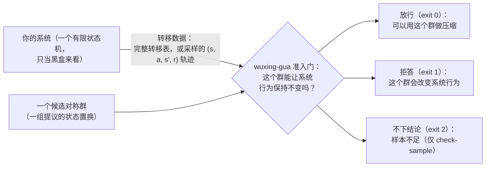

# wuxing-gua（中文版）

> 📄 你正在看：**简体中文版** ｜ [🇬🇧 Switch to English](README.md)
> 本文件与英文版结构逐节对应；术语的一句话解释见 [docs/glossary.md](docs/glossary.md)。

先说人话。假设你在维护一个有几万个状态的系统——工单调度、游戏战斗逻辑、协议实现，都算。你听说可以利用「对称性」把状态压到几百分之一，算得飞快。**这招是真的**，但有个几乎没人提的前提：你得先确定那个对称性是**真的**。用错了，压缩之后的系统会悄悄算出错的结果——不报错、不警告，你就是不知道。

这个工具就干一件事：**压缩之前，先把对称性过一遍安检**。结论只有三种——放行、拒答（并告诉你它错在哪）、或者明说「数据不够，我不下结论」。它不帮你压缩，它只负责替你挡住那个会让你白算一场的错误。

  

---

## 1. 为什么（Why）

我们做这个工具，是因为自己被坑过两次。

第一次，是项目里的一个漂亮数字——某个系统里机器找到的对称群比人工给的大了几千倍，我们拿它当了很久的招牌结论。后来做对照实验才发现：**同一个系统只是把状态换个编号，那个数字就没了**。13 次重编号里只对 2 次。原来的「发现」不是能力，是运气。我们把这个坑量化清楚（91 组对照实验），然后做出三个修复开关，才敢把「发现」重新当回事。

第二次，是我们自己的置信度模块报了满格警报——「这个群没找全」。换别的工具，这就是结论了。我们多走了一步：写了个暴力验证程序直接穷举，证明工具其实找全了，是置信度在新环境形态下误报。这次误报没有藏着，它变成了文档里的一条已知边界和一个强制提示。

这两次教训汇成同一个认识：**对称性这门技术缺的不是更好的压缩算法，而是压缩前面那道门**——当你手上只有黑盒数据（完整转移表，或 `(s,a,s',r)` 采样轨迹）时，「这个对称群用在这个系统上到底安不安全」没有人把关；多数流程甚至没有「拒答」这个出口。wuxing-gua 就是这道门。

具体一点：这里的**对称群**是一组让系统行为保持不变的状态置换——把状态按群中任一元素重命名后，所有转移与奖励原封不动。群一旦成立，同一**轨道**（群能把彼此搬来搬去的那批状态）里的状态就可以互换，压缩时每个轨道留一个代表态即可。候选群到底成不成立，正是这个工具要裁决的事。

wuxing-gua 把这件事做成一个**可拒答的准入门**，由四个可组合的部件构成：

- **发现**（`discover`）：只从转移数据自动找候选对称群（多路候选生成 + 编号鲁棒化 + 完整性告警）；
- **零容忍验证**（`check`）：候选群的**每个元素**都要过等变检验与奖励剖面检验，任何一处不过即拒答；
- **采样版判定**（`check-sample`）：没有完整转移表时，用采样轨迹 + 顺序统计判据回答「能不能放行」；样本不足就明说，绝不因为「没看出差异」而放行；
- **校准置信**（`--report-confidence`）：证书静默时给出可解释、可校准的「这个群找全了吗」判读。

定位是**组合式的**：它不替代任何既有的对称性约减实现，而是站在它们前面，回答「该不该用、能不能拒答」这两个前置问题。

整个约定一张图：



本页用到的每个术语——轨道、等变、全变差、生成元、哑态……——都在 [docs/glossary.md](docs/glossary.md) 里有一句话解释（英文）。

## 2. 60 秒上手

要求：Python ≥ 3.10，零第三方依赖（纯标准库）。

**最快的第一份价值——无需安装。** 在仓库根目录：

```bash
python -m wuxing_gua discover --trans examples/ticketfsm_milestones_model.json
```

这条命令秒级判完一个真实的 32 态工单模型并打印找到的群（exit 0：群阶 2、24 轨道）。第一次接触对称群？先下一级台阶：[examples/](examples/) 里的 8 态起步立方体，它的对称性在纸面图上直接可见——还配了一个「看似合法实则被拒」的群。所有命令都可以这样跑——在仓库根目录直接 `python -m wuxing_gua ...`——因为判据核心从同一目录树的 `src/` 导入，这是设计使然（见 `pyproject.toml` 头注）。只有当你想在别的目录也能用这些命令时才需要安装：

```bash
pip install .
python -m wuxing_gua demo --out demo_fixtures   # 生成确定性演示夹具（秒级）
python -m wuxing_gua selftest                   # 端到端自检：13 个分支全 PASS、退出码 0
```

一条 `discover` 示例（演示夹具 Q₆ 标准环境，64 状态）：

```bash
python -m wuxing_gua discover --trans demo_fixtures/model_q6.json
```

stdout 输出可解析 JSON：`order=720`、`n_orbits=7`，并附 `completeness` 完整性告警块；输出 JSON 本身就是合法的 group 文件，可直接喂给 `check` 复核。进度与诊断走 stderr。每个字段什么意思、下一步该做什么：[docs/interpreting-output.md](docs/interpreting-output.md)。

要在自己的系统上运行，需要把系统行为写成符合位串口径（bit-string convention）的 JSON 转移模型（`n_states = 2**n_bits`、动作 `a` = 翻转第 `a` 位）；model / group / samples 三种文件的具体格式见 [wuxing_gua/README.md](wuxing_gua/README.md)。最高频的问题——格式、样本量、被拒答之后怎么办——见 [docs/faq.md](docs/faq.md)。

## 3. 退出码语义（全命令统一）

| 退出码 | 含义 |
|---|---|
| `0` | 可用：check / check-sample 判据通过；discover 找到非平凡群 |
| `1` | 拒答：群不可用/非法；discover 只找到平凡群（阶 1） |
| `2` | 数据不足：仅 check-sample 的 abstain 档——只说样本不足，不下其他结论 |
| `3` | 输入或内部错误 |

准入判据一句话：**零容忍等变 + 奖励剖面**——候选群每个元素的最大全变差 TV ≤ 1e-9（数值零），且同轨道状态的奖励剖面零违约；两层全过才放行，任何一层不过即拒答（退出码 1）。

## 4. 证据

三个真实系统案例（黑盒转录为转移模型，运行前预注册判定规则），关键读数全部可溯源（索引见 [docs/evidence.md](docs/evidence.md)）：

| 案例 | 模型规模 | 预注册判定 | 关键读数 |
|---|---|---|---|
| ticketfsm（工单派发状态机） | 32 态 × 5 动作 | 主预期命中 | check 两层通过；群阶 2 = 独立暴力验证的 \|Aut\|；轨道 24，压缩读数 1.333× |
| GameWXXX（相生链 × 轮转场） | 512 态（465 真实 + 47 哑态） × 7 动作 | 修复闭环 | check（阶 5 群）两层通过（exit 0）；discover 修复后 `--pad-aware` 找回同一阶 5 群（exit 0）；120,000 条引擎真实执行与转录 100.000% 一致；抽象群阶 75、位串可见阶 5（编码几何边界） |
| GameWXXX（团队战） | 16,384 态（14,415 真实 + 1,969 哑态） × 11 动作 | 主预期命中 | check（阶 25 群）两层零容忍全过：25/25 元素 TV = 0.00e+00、奖励剖面 0 违约 / 176,640 对；轨道 1,024，压缩读数 16.0×；对照的 125 阶抽象群被拒且通过集恰为该阶 25 群；discover 3,600 s 干净超时（该规模的硬预算边界） |

独立校准与对抗测试：

- **置信判别分**：9 环境 × 13 编号矩阵、115 实例——AUC = 1.0，两端错误率 0；
- **对抗误通过**：100 个「应拒答」构造案例，0 个误放行（0/100）。

「预注册判定」列怎么读：每个案例的结局档位与判定规则都在运行前**先写死**（预注册），「主预期命中」说的是运行结果与这条先声明规则吻合，而非事后解读；「修复闭环」指该案例先发现缺陷、修复、再复跑验证修复有效。先声明的规则原文见 [docs/evidence.md](docs/evidence.md)（锚点 E6、E17）。

压缩比只作为**读数**报告，不构成收益主张——对小规模模型，工具的正确产出常常是「证明没有更大的可利用对称」这类负结果式放行。

## 5. 六标志速查

| 标志 | 作用 | 何时用 |
|---|---|---|
| `--preset robust`（推荐） | 一键三开：`--canonize` + `--extra-candidates` + `--multi-label 8`，并切到泛化判据 | 不确定输入形态时的默认选择 |
| `--canonize` | 规范化重编号后再跑同一搜索，消除编号伪像 | 输入编号可能不「自然」 |
| `--multi-label K` | K 个随机重编号臂的生成元并集取闭包（K 可由 `--seed` 控制） | canonize 被 suppress / 不适用的环境 |
| `--extra-candidates` | 追加动作置换候选源 | 动作本身是对称双射的模型 |
| `--pad-aware` | 哑态商图臂，修复含哑态模型的候选生成 | 模型含全自环哑态（n_states = 2^n_bits 补齐产生） |
| `--report-confidence` | 附加只读 confidence 诊断块 | completeness 无证书时辅助判读 |

口径一句话：**非位串动作模型**（动作 ≠ 翻第 a 位）必须走 `--preset robust` 或任意两标志组合（泛化判据）；单标志臂的位串判据对这类模型会如实拒答或报错，绝不误放行。

## 6. 诚实边界

- **规模带（实测口径）**：check 层在 16,384 态完整表上可用（两层零容忍，秒级量级）；discover 层的实测收敛带在 512 态带（`--pad-aware`，分钟量级），16,384 态上 3,600 s 预算干净超时——该规模的自动发现是已声明的硬预算边界，不是「不可能」。
- **逐元素验证上限**：群阶 ≤ 5,000 逐元素全查；更大的群自动切换哨兵抽查（依据等变关于复合封闭的数学论证）。
- **置信层是经验标定**：统计阈值在 9 环境 × 13 编号矩阵（115 实例）上标定，**不是数学保证**；分布外环境（自环密集 + 吸收态 + 门控的真实业务形态）可能出现假疑点——实测就有过一例：ticketfsm 上置信统计层报 `statistical_suspicion`（wl_gap = 6.0 满格），而独立暴力验证证明 \|Aut\| = 2、群已完整。因此疑点档强制附「分布外环境提示」，且 confidence 块只读、永不改变退出码。
- **采样版门槛**：需要 ≥ 10,000 条采样轨迹（经验标定门槛）；低于门槛报 abstain（退出码 2），不会靠放宽判据凑放行。含哑态的模型上，哑态轨道不可采样，采样判定会**结构性** abstain——这是协议设计的限制，不是样本量问题。
- **可见对称 ≤ 抽象对称**：位串编码的仿射约束会砍掉部分抽象自同构（实测 75 → 5 与 375 → 25 两例，机理同源）——工具如实报告可见群，不冒充抽象群。

## 7. 文档、许可与贡献

- **文档**：[docs/evidence.md](docs/evidence.md)（每个数字的溯源索引）· [docs/glossary.md](docs/glossary.md)（核心术语的通俗解释，英文）· [docs/interpreting-output.md](docs/interpreting-output.md)（输出逐字段的人话解读，数值即实跑值）· [docs/faq.md](docs/faq.md)（最高频问题速答，英文）· [docs/quickstart.md](docs/quickstart.md) · [docs/boundaries.md](docs/boundaries.md) · [docs/negative-results.md](docs/negative-results.md) · [wuxing_gua/README.md](wuxing_gua/README.md)（标志 × 判据全表、文件结构与出处、已知限制）· [CHANGELOG.md](CHANGELOG.md) · [CONTRIBUTING.md](CONTRIBUTING.md)
- **示例**：[examples/](examples/) 是一座六级阶梯——对称性可画在纸上的 8 态起步立方体（`tier1_starter_model.json`）、可复跑的拒答演示（`tier1_xor_goalswap_group.json`）、上述三个真实案例的转移模型与群文件（32 态一档附错误候选对照），以及采样版 `check-sample` 一档（abstain/pass 双演示 + 任意样本量都如实拒答的边界演示），附实跑记录的预期输出，可直接复跑。
- **许可**：MIT（见 [LICENSE](LICENSE)）；如需亦可改用 Apache-2.0（全文见 [licenses/LICENSE-Apache-2.0.txt](licenses/LICENSE-Apache-2.0.txt)）。
- **贡献**：欢迎 issue——bug 报告、使用场景，**负结果也同样欢迎**（「这个群被判拒答/超时」与「判对了」同样有价值）。
